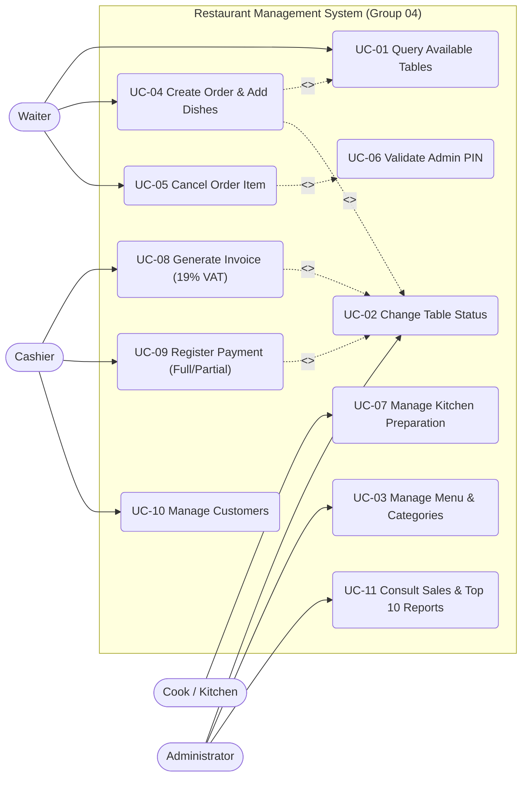
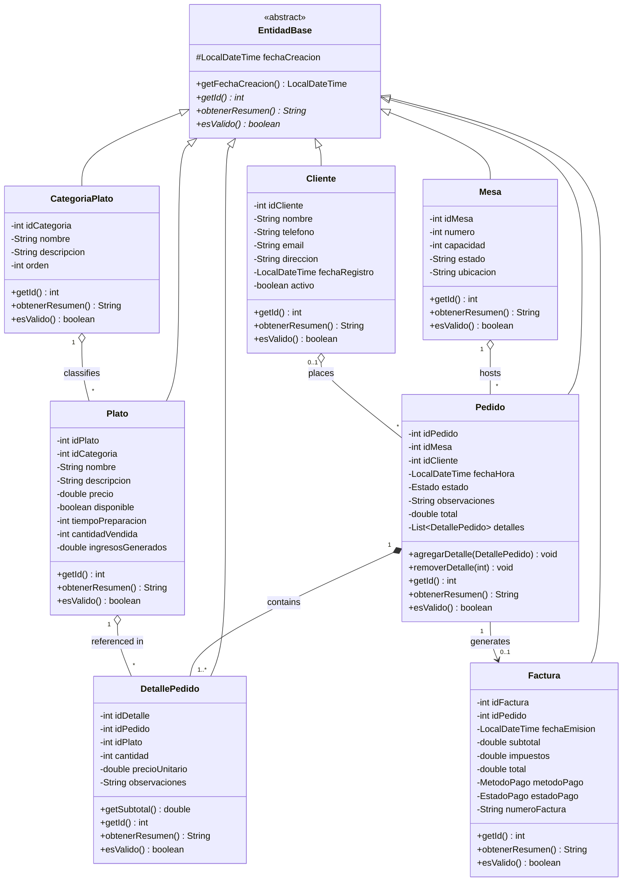
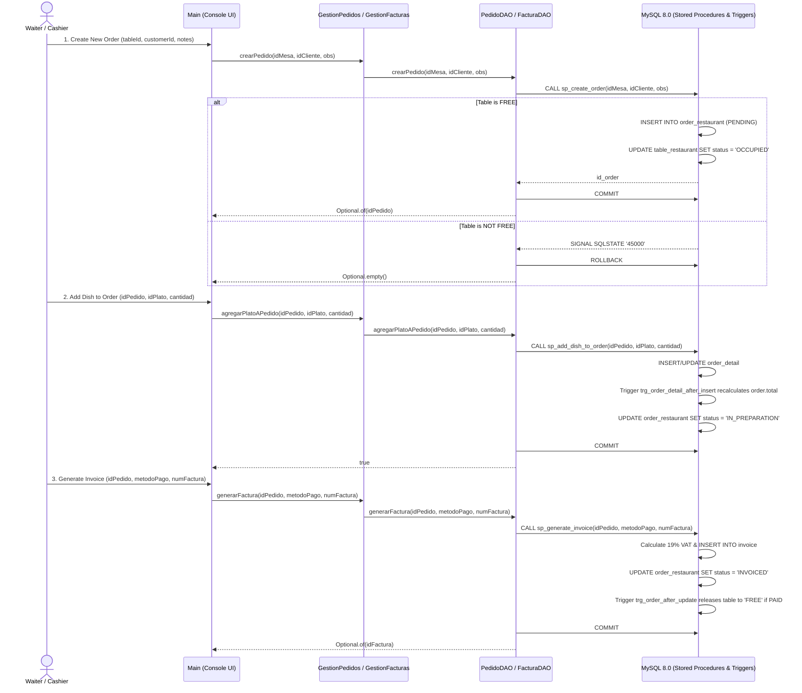
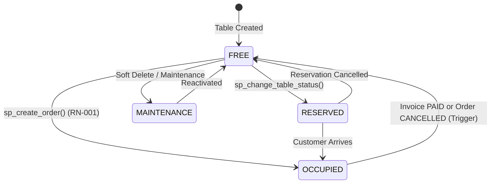

# Phase 3: UML Modeling and Object-Oriented Design

**Project**: Restaurant Management System (Group 04)  
**Cohort**: 3239188 - SENA ADSO  

This document presents the UML diagrams synchronized 100% with the implemented Java codebase (`src/`) and the MySQL 8.0 relational schema (`database/restaurante_db.sql`).

---

## 1. OOP Principles Applied in Code

1. **Inheritance (`Herencia`)**: All 7 domain models (`Mesa`, `Cliente`, `CategoriaPlato`, `Plato`, `Pedido`, `DetallePedido`, `Factura`) extend the abstract superclass `EntidadBase` (`src/modelo/EntidadBase.java`), inheriting `fechaCreacion` and the contract methods `getId()`, `obtenerResumen()`, and `esValido()`.
2. **Polymorphism (`Polimorfismo`)**: Each subclass overrides `obtenerResumen()` and `esValido()` with its own domain-specific formatting and validation rules. `Main.mostrarResumenPolimorfico()` processes a heterogeneous `List<EntidadBase>` polymorphically.
3. **Encapsulation (`Encapsulamiento`)**: All attributes are `private` (or `protected` in `EntidadBase`) and accessed exclusively through getters, setters, and domain methods.
4. **Composition & Aggregation (`Composición y Agregación`)**: `Pedido` owns a collection `List<DetallePedido>` (composition) and recalculates its total automatically when items are added or removed.

---

## 2. Use Case Diagram

---

## 3. Class Diagram (Model, DAO, and Service Layers)

---

## 4. Sequence Diagram: Create Order, Add Dishes, and Generate Invoice

---

## 5. State Machine Diagram: Table and Order Lifecycle

