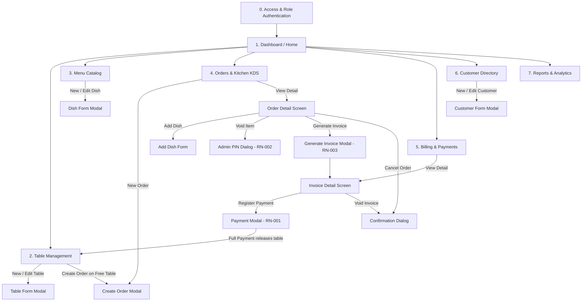

# Phase 5: Interactive Navigable Mockup / Prototype

## 1. Overview

This directory contains the **interactive, navigable HTML/CSS/JS prototype** for the **Restaurant Management System (SENA ADSO — Group 04)**. It runs 100% offline in any modern web browser with zero external dependencies and simulates every functional requirement (`RF-001`–`RF-010`), user story (`HU-01`–`HU-15`), and business rule (`RN-001`–`RN-004`) defined in Phases 1–4.

### How to Open
1. Open `mockup/index.html` directly in Chrome, Edge, Firefox, or Safari (double-click or drag into a browser tab).
2. On the **Access / Authentication** screen, pick a role:
   - **Administrator** (PIN: `1234`) — full access to all modules and item voiding (`RN-002`).
   - **Waiter** — tables, menu view, order creation, and kitchen tracking.
   - **Cashier** — invoicing, partial/full payments, pending invoices, and reports.
   - **Kitchen Staff** — kitchen display board (KDS) and order preparation statuses.
3. Click **Enter System** (or **Quick Demo Login**) to navigate interactively through all screens.

---

## 2. Screen Navigation Flow

---

## 3. Screen Catalog & Requirements Traceability

| # | Screen / Component | Rubric Criterion Covered | Requirements / Stories | Business Rules Demonstrated |
|---|--------------------|--------------------------|------------------------|-----------------------------|
| 0 | **Access & Role Login** | Authentication / access screen | Role-based access, `RN-002` | Admin PIN (`1234`) validation + invalid PIN error alert |
| 1 | **Dashboard / Home** | Home / main menu + clear navigation | Overview of `RF-001`–`RF-010` | Real-time KPIs synced with live in-memory state |
| 2 | **Table Management** | Data listing + Floor Map + Form | `RF-001`, `HU-01`, `HU-02` | Capacity 1–20 (`RN-004`), blocks freeing occupied tables with active orders (`RN-001`) |
| 3 | **Menu Catalog** | Data listing + Search/Filter + Form | `RF-002`, `HU-03`, `HU-04`, `HU-05` | Price > 0 (`RN-004`), availability toggle, soft-delete confirmation |
| 4 | **Orders & Kitchen Display (KDS)** | Data listing + Status tabs + Form | `RF-003`, `RF-004`, `HU-06`, `HU-07`, `HU-08`, `HU-15` | Strict lifecycle transitions (`PENDING -> IN_PREPARATION -> READY -> DELIVERED`) |
| 5 | **Order Detail View** | Record detail screen + Action modals | `RF-003`, `RF-004`, `HU-07`, `HU-08` | Item void requires Admin PIN (`RN-002`), live total recalculation |
| 6 | **Billing & Payments** | Data listing + Generate Invoice Form | `RF-005`, `RF-006`, `HU-09`, `HU-10` | Automatic 19% VAT calculation (`RN-003`), cash auto-paid |
| 7 | **Invoice Detail & Payment Modal** | Record detail screen + Payment Form | `RF-005`, `RF-006`, `HU-09`, `HU-10` | Partial & full payments, overpayment rejection, automatic table release (`RN-001`) |
| 8 | **Customer Directory** | Data listing + Search + Form | `RF-007`, `HU-11`, `HU-12` | Email uniqueness & format validation, phone format validation |
| 9 | **Reports & Analytics** | Queries & reports screen | `RF-009`, `RF-010`, `HU-13`, `HU-14`, `HU-15` | Daily sales by payment method, Top 10 dishes chart, orders by status |
| 10 | **Dialogs, Validation & Toasts** | Error & confirmation messages | All `CA-001`–`CA-009` | Inline form errors, confirmation modals before destructive actions, toast alerts |

---

## 4. Files

| File | Description |
|------|-------------|
| `mockup/index.html` | Application shell, login screen, sidebar navigation, all 7 module views, record detail drawers, forms, and dialogs |
| `mockup/styles.css` | Self-contained responsive stylesheet with high-contrast status badges, floor map cards, order lifecycle stepper, and chart bars |
| `mockup/app.js` | Interactive client-side controller pre-loaded with the sample dataset from `database/restaurante_db.sql` and enforcing `RN-001`–`RN-004` |
| `mockup/README.md` | Prototype guide, Mermaid navigation flow, and requirements traceability matrix |
